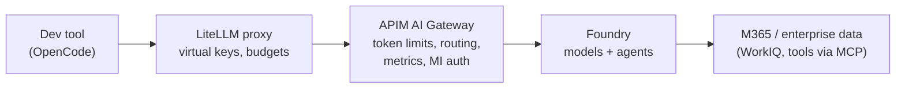
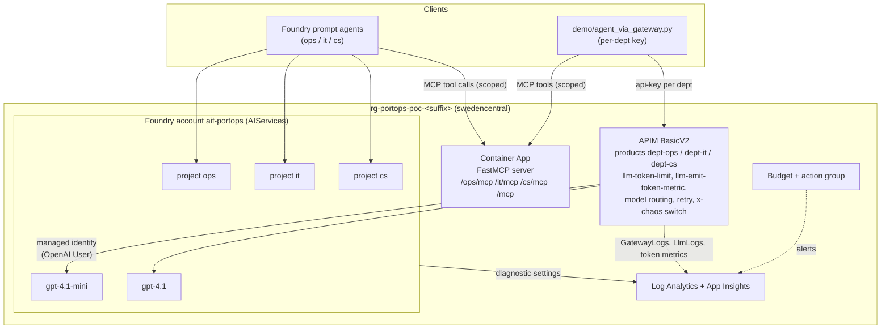
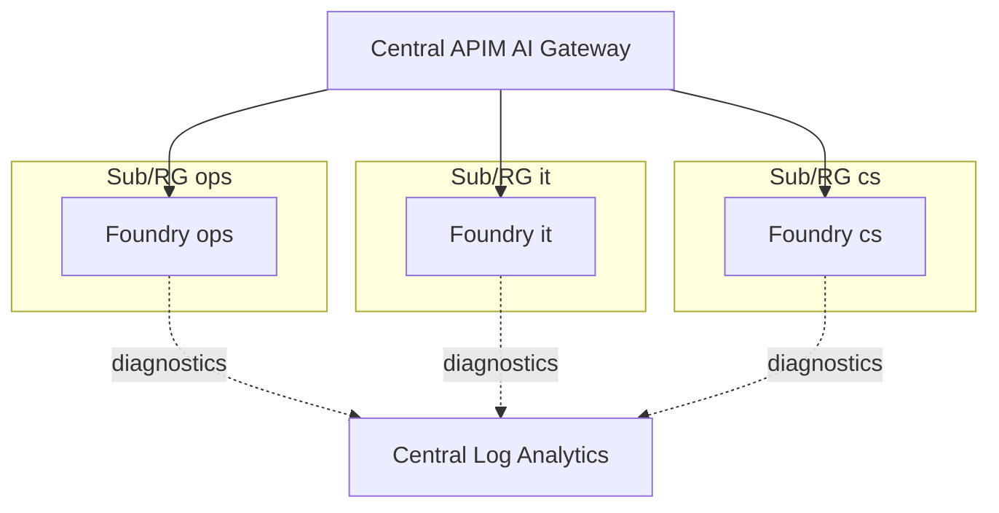

# Architecture

PoC for the "Terminal Ops Assistant": many teams, one gateway, costs visible per team, agents with controlled tool access. All data is synthetic (fictional *Northport Container Terminal*).

## Layer picture (where a customer stack fits)

LiteLLM and APIM are complementary: LiteLLM gives developers per-user keys and a provider-neutral API; APIM adds Azure-native identity, enforced token quotas, backend pools/circuit breaking and telemetry in Azure Monitor. See [litellm-vs-apim.md](litellm-vs-apim.md).

## Option B (PoC): one central platform, one project + product per department

Key points
- One Foundry resource, three projects: each project tags usage with `project` so Cost analysis can split cost per department (preview, Models sold by Azure only).
- One APIM product + subscription key per department: the key identifies the department (`Department` metric dimension) and carries the token quota.
- APIM calls Foundry with its managed identity (no keys).
- Tool scope per department is enforced at the MCP endpoint (`/<dept>/mcp`) and in the agent's `allowed_tools`.
- MCP is governed at the gateway too: agents and clients call `https://<apim>/mcp/<dept>` (native APIM MCP API, team key or Entra `Team.*` role, per-team tool allow-list, rate limit, `McpToolCalls` metric); the Container App only accepts calls carrying the APIM-injected `x-mcp-key`. See [mcp-governance.md](mcp-governance.md).

## Foundry traffic through the gateway

`scripts\setup-foundry-gateway.ps1` creates two connections in each department project, both pointing at `https://<apim>.azure-api.net/openai` with that department's APIM subscription key (read with `listSecrets` at runtime, stored only in the Foundry connection):

| Connection | Category | Used by |
|---|---|---|
| `apim-gateway-<dept>` | `ApiManagement` (metadata `deploymentInPath=true`, `inferenceAPIVersion=2024-10-21`, static `models` list) | Foundry prompt agents and Responses calls, model name `apim-gateway-<dept>/gpt-4.1-mini` |
| `apim-gateway-aoai-<dept>` | `AzureOpenAI` | Playground / Azure OpenAI-style clients (colleague pattern) |

Connection names are unique per Foundry account, hence the `-<dept>` suffix. Agent Service only calls `POST /deployments/{id}/chat/completions`, which the existing API already exposes, so no new APIM operations were needed: department product, token limit, metrics, routing and logging apply unchanged. `create_foundry_agents.py` uses the gateway model by default (`--direct` bypasses APIM). Caveats: the feature is preview and documented for Standard v2/Premium (works on BasicV2 here); tool calls to the MCP server still go straight from Agent Service to the MCP endpoint, only model calls pass APIM.

## Option A (alternative): one Foundry resource per department

| | Option B (PoC) | Option A |
|---|---|---|
| Cost split | `project` tag + APIM product | Native: one resource/RG/sub per dept |
| Quotas (TPM) | Shared pool per deployment; gateway limits per dept | Own quota per resource |
| Isolation / RBAC | Project-level | Resource/subscription level |
| Ops effort | Low | Higher (N resources, N networks) |
| Blast radius | Shared | Contained |

## Call shape

`POST {APIM_GATEWAY_URL}/openai/deployments/{model}/chat/completions?api-version=2024-10-21` with header `api-key: <department key>`. `model=auto` lets the gateway route (small model by default, large for long/"analy..." prompts). Response headers: `apim-request-id`, `x-portops-department`, `x-portops-routed-model`, remaining/consumed tokens.
