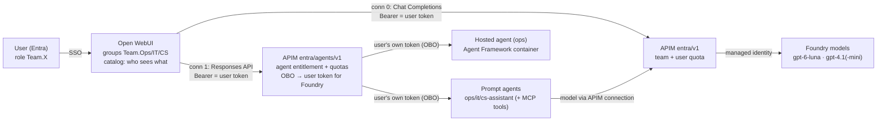

# Open WebUI: teams, models, workspace models and Foundry agents (as the user)

Builds on [openwebui-entra-gateway.md](openwebui-entra-gateway.md) (user token → APIM → raw models). This adds:
- **Foundry agents in Open WebUI**: prompt agents and **hosted agents** (code: Agent Framework, LangChain, etc.).
- **Agents run as the signed-in user**: APIM exchanges the user's token on-behalf-of (OBO) for a Foundry token, without a secret.
- **Per-team visibility** of raw models, workspace models (use-case presets) and agents, enforced in three places: Open WebUI, APIM and Foundry RBAC.

## Architecture



### Identity per hop (agents)

| Hop | Credential | Identity at the receiver | Enforced here |
|---|---|---|---|
| Open WebUI → APIM `entra/agents/v1` | user access token (aud = gateway, `roles` Team.X) | user, team, calling app | 401 without a team role; **agent entitlement** (agent's project = user's team, otherwise 403 `AgentNotAllowed`); team kill switch; team + user token quota; metrics with `Model = agent:<name>` |
| APIM → Entra (token endpoint) | OBO grant: `assertion` = user token, client = gateway app, `client_assertion` = APIM **managed identity** token (federated credential, no secret) | — | user consent/Conditional Access for the downstream resource; token cached per user (~55 min) |
| APIM → Foundry agent | **user's** token for `https://ai.azure.com` | **the user** | **Foundry RBAC**: *Foundry User* on the team's project only (`sg-portops-team-<x>` → project `<x>`); agent sessions are isolated per user (`isolation_key_source: Entra`) |
| Agent → tools/models | prompt agent: model via the APIM connection (dept key); MCP via APIM (`mcp-gateway-<dept>`) | agent/project identity | dept quota, MCP tool allow-list |

### Why "as the user" matters
- **Access control at the source**: Foundry checks the *user's* role on the project. A user of team IT can't call an Ops agent, even with a hand-crafted request.
- **Isolation**: hosted agents isolate conversations/state per caller (`authorization_schemes: Entra`). If every call came from APIM's managed identity, all users would share one isolation key.
- **Audit**: Foundry/agent logs show the real user.
- **Data access**: for user-scoped sources (SharePoint, mail), tools should also pass the user's identity through (SharePoint tool identity passthrough; MCP OAuth passthrough). Shared system data can use the agent's own least-privilege Entra Agent ID. Never use broad app-only permissions.

## Who sees what (`openwebui/catalog.json`)

| Open WebUI entry | Type | Team.Ops | Team.IT | Team.CS |
|---|---|:-:|:-:|:-:|
| GPT-6 Luna, GPT-4.1 mini | raw model | ✅ | ✅ | ✅ |
| GPT-4.1 | raw model | ✅ | | |
| Ops · Hosted agent (Agent Framework) | hosted agent | ✅ | | |
| Ops · Terminal Ops Assistant | prompt agent + MCP | ✅ | | |
| IT · Log Analyst | prompt agent + MCP | | ✅ | |
| CS · Customer Service Assistant | prompt agent + MCP | | | ✅ |
| Ops · Shift handover writer | workspace model (GPT-6 Luna + prompt) | ✅ | | |
| IT · Incident summarizer | workspace model (GPT-6 Luna + prompt) | | ✅ | |
| CS · Customer reply drafter | workspace model (GPT-4.1 mini + prompt) | | | ✅ |

Same rule, three layers: Open WebUI hides what you may not use (UX), APIM refuses it (403), Foundry RBAC refuses it (403).

To add an agent:
1. Add `model-id=project|agent-name|prompt|hosted` to the `catalog` variable in `infra/policies/openai-entra-agents-policy.xml`.
2. Add the model ID to `OPENAI_API_CONFIGS` connection 1 in `openwebui/docker-compose.yml`.
3. Add an entry with its groups to `openwebui/catalog.json`.
4. Run `setup-apim-entra-v1.ps1` and `setup-openwebui-catalog.ps1`.

## Setup (after openwebui-entra-gateway.md)

The catalog expects a **hosted agent** named `agent-framework-agent-basic-responses` in project `ops`. Any agent that speaks the Responses protocol works, e.g. the Agent Framework "basic responses" template deployed with `azd ai agent` (Foundry hosted agents). If you use another name, change the `catalog` variable in the agents policy. The prompt agents `portops-<dept>-assistant` come from `demo\create_foundry_agents.py`.

```powershell
.\scripts\setup-openwebui-agents.ps1     # OBO (delegated https://ai.azure.com + federated credential for APIM MI), Foundry User per team project,
                                         # Team.* app roles on the Open WebUI app, persona names for the demo users
.\scripts\setup-apim-entra-v1.ps1        # deploys entra/v1 AND entra/agents/v1
docker compose -f openwebui\docker-compose.yml up -d
# sign in once as admin, then:
.\scripts\setup-openwebui-catalog.ps1    # groups + model/agent entries with access grants (mints a local admin token itself)
```

## Live demo runbook (≈10 min)

Personas: synthetic users in the demo tenant. Passwords are in `.env` (`PORTOPS_TESTUSER_*_PASSWORD`). Each user registers MFA on first sign-in, so do that **before** the session.

| Persona | UPN | Team | Sees |
|---|---|---|---|
| Lena Hoffmann (Ops) | `portops-ops-user@…` | Team.Ops | 3 raw models, 2 Ops agents (incl. hosted), Ops workspace model |
| Jonas Weber (IT) | `portops-it-user@…` | Team.IT | 2 raw models, IT Log Analyst, IT incident summarizer |
| Mira Schulz (Customer Service) | `portops-cs-user@…` | Team.CS | 2 raw models, CS assistant, CS reply drafter |

Use one browser profile or InPrivate window per persona, all on `http://localhost:3000`.

1. **Lena (Ops)**: open the model picker and point out the Ops agents and the hosted agent. Ask *Ops · Terminal Ops Assistant*: "Which vessels are expected in the next 48 hours, and at which berth?" (MCP tool call). Then ask *Ops · Hosted agent* something.
2. **Jonas (IT)**: different picker, no Ops agents. Ask *IT · Log Analyst*: "Summarize the most recent critical incidents."
3. **Enforcement beyond the UI** (terminal, as Jonas or with your own token as Ops): call `entra/agents/v1/responses` with `"model":"ops-assistant"` → **403 AgentNotAllowed** at APIM. Foundry RBAC is the second line: Jonas only has *Foundry User* on project `it` (not yet demoed live).
4. **Per-user budget**: `setup-apim-entra-v1.ps1 -UserQuota 100`, chat twice as Lena → 403 "Token quota is exceeded…" in the chat; Jonas keeps working. Restore with `-UserQuota 200000`.
5. **Reporting**: Log Analytics → `AppMetrics` by Team/User/ClientApp/Model (agents appear as `agent:<name>`).

```kusto
AppMetrics
| where TimeGenerated > ago(1h) and Name == "Total Tokens"
| summarize tokens = sum(Sum) by Team = tostring(Properties.Team), User = tostring(Properties.User), Model = tostring(Properties.Model)
| order by tokens desc
```

## Results (2026-11-04, demo admin = Team.Ops)

| Test | Result |
|---|---|
| gpt-6-luna via `entra/v1` | ✅ 200 |
| Hosted agent via APIM (OBO, as the user), API + Open WebUI chat | ✅ 200; streaming events pass through (incl. reasoning "Thought"); multi-turn OK after history normalization; first call ~20 s (cold start) |
| Workspace model "Ops · Shift handover writer" (gpt-6-luna + system prompt) | ✅ structured handover |
| gpt-6-luna multi-turn in Open WebUI | ✅ via connection 2 (Responses API) |
| Prompt agent `ops-assistant` with MCP tools in Open WebUI | ✅ 200, 9 vessels with berths from the ops MCP server |
| `it-assistant` as a Team.Ops user | ✅ 403 `AgentNotAllowed` |
| `/models` on the agents API | ✅ lists only the caller's team agents |

## Troubleshooting

| Symptom | Cause / fix |
|---|---|
| 502 `OboFailed` + AADSTS message | Federated credential/consent missing → re-run `setup-openwebui-agents.ps1`; the subject must be the APIM MI principal ID |
| `Hosted agents can only be called through the agent endpoint` | hosted agents use `/agents/<name>/endpoint/protocols/openai/responses?api-version=v1`, not `/openai/v1/responses` + agent_reference |
| `Not allowed when agent is specified` | prompt agents reject instructions/tools/temperature next to `agent_reference`; the policy forwards only `input` + `stream` |
| `request body failed schema validation` (hosted agent, 2nd turn) | Open WebUI replays stored Responses output items (ids, status, annotations, reasoning/tool items); the policy normalizes the history to plain `{role, content}` messages |
| `api-version query parameter is not allowed when using /v1 path` | only the hosted-agent path takes `api-version=v1` |
| User sees no models | Open WebUI shows only entries with an access grant for the user's group; group membership syncs at sign-in (sign out/in after role changes) |
| 403 from Foundry (not APIM) | the user lacks *Foundry User* on that project (RBAC propagation can take a few minutes) |

## Caveats

- Hosted agents receive the user's token at the agent endpoint. Whether the container gets user context for its own downstream calls depends on the agent code/toolbox auth (identity passthrough). Test per tool.
- Open WebUI conversation history: Open WebUI sends the full `input` each turn (stateless). Server-side Foundry conversations (`conversation`/`previous_response_id`) aren't used.
- Prompt agents call their model through the dept-key APIM connection, so tokens are metered twice (agent API per user + model API per dept). Filter by API when reporting.
- Open WebUI's `system_oauth` token is refreshed with `offline_access`. After a long idle time, users may need to sign in again.
