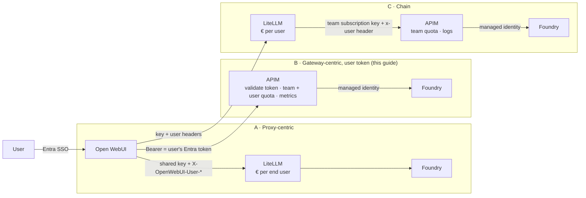
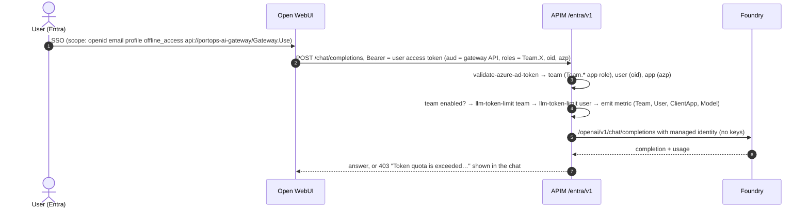

# Open WebUI + Entra ID + AI Gateway: identity, per-user/team limits and budgets

How to connect **Open WebUI** to the **APIM AI Gateway** so the signed-in user's **Entra ID identity reaches the gateway**. The gateway can then enforce limits per team and per user, and report usage per team, user and app, without a separate proxy licence or shared API keys. The guide also compares this with LiteLLM-based setups ("the onion": chat UI → proxy → gateway → models) and explains what each layer should own.

Tested on 2026-11-04 with Open WebUI v0.13.0 and APIM Basic v2 against this repo's deployment.

---

## 1. The problem: identity continuity

A chat UI such as Open WebUI authenticates the **real person** (Entra SSO). Everything downstream usually sees only **one service identity**: a shared API key or a managed identity. Without propagating *who* the user is and *which team* they belong to, the layers below the UI can't meter or enforce anything per user or team.

Typical requirements:
- One AI budget, split by department → team → user, with a **hard stop** when it's used up.
- Budget in **money**, not tokens. Model prices differ.
- Near real-time. Azure Cost Management lags by hours.
- An approval process: access is granted through group membership.
- Coverage for **models and agents**.
- Low operational burden; GA services preferred over preview.

## 2. Facts that shape the design (verified 2026-11-04)

| Topic | Fact | Source |
|---|---|---|
| Money-based hard stop | **No native mechanism** in Azure OpenAI/Foundry/APIM. Cost Management budgets only alert, and cost data lags 8–24 h. Hard stops come from gateway **token quotas**; € enforcement means token metrics × a price table → alert → automation (the AI-Gateway *finops-framework* lab). | [Foundry: manage costs](https://learn.microsoft.com/azure/foundry/concepts/manage-costs), [finops-framework lab](https://github.com/Azure-Samples/AI-Gateway/tree/main/labs/finops-framework) |
| `llm-token-limit` | GA, all tiers except Consumption. Rate exceeded → **429**, quota exceeded → **403**. `counter-key` can be any expression (claim, header, subscription). `estimate-prompt-tokens` is **required**. | [llm-token-limit](https://learn.microsoft.com/azure/api-management/llm-token-limit-policy) |
| `llm-emit-token-metric` | GA. Max **5 custom dimensions**, ≤100 values per dimension, 1,000 time series per namespace. Beyond that, data is dropped silently, so for many users use the LLM logs as the source. | [llm-emit-token-metric](https://learn.microsoft.com/azure/api-management/llm-emit-token-metric-policy), [LLM logs](https://learn.microsoft.com/azure/api-management/api-management-howto-llm-logs) |
| `validate-azure-ad-token` | GA. Claims (`oid`, `roles`, `azp`) can be used as counter keys and dimensions. | [validate-azure-ad-token](https://learn.microsoft.com/azure/api-management/validate-azure-ad-token-policy) |
| Open WebUI: token forwarding | A connection with `auth_type: "system_oauth"` forwards the user's **OAuth access token** as `Bearer`. One token serves all OAuth connections; there is no per-connection scope. | [Open WebUI SSO](https://docs.openwebui.com/features/authentication-access/auth/sso/), `backend/open_webui/utils/headers.py` |
| Open WebUI: user headers | `ENABLE_FORWARD_USER_INFO_HEADERS=true` → `X-OpenWebUI-User-Name/-Id/-Email/-Role`. With `FORWARD_USER_INFO_HEADER_JWT_SECRET` set, it sends one **signed HS256 JWT** (`X-OpenWebUI-User-Jwt`) instead. | [env configuration](https://docs.openwebui.com/reference/env-configuration/) |
| Open WebUI: budgets | None. Usage display only. | same |
| LiteLLM: end users | `general_settings.user_header_mappings` maps e.g. `X-OpenWebUI-User-Email` to an end user with a € budget (OSS, needs Postgres; without a DB, budgets fail open). On a team key only team budgets apply. Hitting any budget **blocks**; there is no fallback from user to team budget. | [LiteLLM customers](https://docs.litellm.ai/docs/proxy/customers), [Open WebUI tutorial](https://docs.litellm.ai/docs/tutorials/openweb_ui), [budgets](https://docs.litellm.ai/docs/proxy/users) |
| LiteLLM → APIM | `Authorization` is **never** forwarded upstream. `x-*` headers are (`forward_client_headers_to_llm_api`). JWT auth and SSO beyond 5 users are listed as Enterprise features. | [forward client headers](https://docs.litellm.ai/docs/proxy/forward_client_headers), [enterprise](https://docs.litellm.ai/docs/enterprise) |
| Agents through APIM | Foundry prompt agents can route model calls through APIM via an `ApiManagement` connection (**preview**). MCP tool governance via the AI gateway is also **preview**. | [AI gateway for agents](https://learn.microsoft.com/azure/foundry/agents/how-to/ai-gateway), [tool governance](https://learn.microsoft.com/azure/foundry/agents/how-to/tools/governance) |

## 3. Who owns what

Rule of thumb: **authenticate once at the edge, enforce each budget in exactly one place, meter everywhere you can.**

| Concern | Open WebUI | LiteLLM (optional) | APIM AI Gateway | Foundry |
|---|---|---|---|---|
| End-user authentication | **Entra SSO** | SSO is paid beyond 5 users | validates the user JWT | — |
| Model visibility | groups → model permissions | allowed models per key/team | API/role allow-list | project RBAC |
| Throughput (TPM) | — | rpm/tpm | **`llm-token-limit`** | deployment quota |
| Monthly hard cap | — | € budget | **token quota → 403** | — |
| € budget | — | **native** | € → token quota, or the finops loop | — |
| Per-user/team reporting | — | spend UI | token metrics + LLM logs | — |
| Agents + MCP | tools in the UI | not recommended | **connections + MCP (preview)** | agents, tracing |
| Operations | self-hosted | self-hosted (+ licence?) | managed | managed |

## 4. Architecture options



| Criterion | **A** proxy-centric | **B** gateway + user token | **C** chain |
|---|---|---|---|
| € budget per user | ✅ native | ≈ token quota or finops loop | ✅ (proxy) |
| Team budget | key per team, or JWT (Enterprise) | ✅ Entra app role | ✅ subscription key per team |
| Identity trust | header (needs a trusted hop) | **✅ signed Entra JWT** | header + key |
| Agents / MCP in the same gateway | ✗ | ✅ (preview) | ✅ |
| Azure-side logs (e.g. debugging 5xx) | ✗ | ✅ | ✅ |
| Components to operate | proxy + Postgres | **gateway only (managed)** | both |
| Extra licence | possibly | none | possibly |

Choose **B** when per-team € enforcement plus per-user visibility and per-user token caps are enough. Choose **C** when a precise **per-user € hard stop** is mandatory and you accept running two layers. In C, APIM must accept the user header **only** from the proxy's subscription key or private network, because a user header on its own can be spoofed.

## 5. Option B in detail



- **Teams = Entra security groups** assigned to app roles (`Team.Ops|IT|CS`) on the gateway's app registration (`scripts/setup-entra.ps1`). Granting access means adding someone to a group. Users without a `Team.*` role get **401**.
- **Quotas live in APIM named values** (`quota-team-*`, `quota-owui-user`), so you can change them without editing XML. To turn a € budget into tokens: `tokens = budget ÷ blended price per 1M × 1,000,000` ([budgets-and-limits](budgets-and-limits.md)).
- **One audience per token:** Entra issues the access token for the gateway API only. That's fine here, because Open WebUI only needs the ID token for sign-in. Graph calls with that token (e.g. the profile picture) fail.

### Setup (additive, on top of the base deployment)

```powershell
.\scripts\setup-apim-entra-v1.ps1            # API openai-entra-v1 (path entra/v1) + named value quota-owui-user
.\scripts\setup-openwebui-entra.ps1          # app reg portops-openwebui, admin consent, client secret -> openwebui\.env (git-ignored)
docker compose -f openwebui\docker-compose.yml up -d   # http://localhost:3000
```

Sign in with a user who is a member of `sg-portops-team-*`. To remove: `.\scripts\setup-apim-entra-v1.ps1 -Remove`, `docker compose -f openwebui\docker-compose.yml down -v`, then delete the app registration `portops-openwebui`.

| Where | Setting | Why |
|---|---|---|
| Open WebUI | `MICROSOFT_OAUTH_SCOPE=openid email profile offline_access api://portops-ai-gateway/Gateway.Use` | access token audience = gateway API; `offline_access` for refresh |
| Open WebUI | `OPENAI_API_CONFIGS` with `auth_type: "system_oauth"` and `model_ids` | forward the user's token; a static model list avoids a `/models` call without a user |
| Open WebUI | `OAUTH_EMAIL_CLAIM=preferred_username` | some users have no `email` claim |
| Open WebUI | title/tag/follow-up generation off | background tasks would also spend the user's quota |
| APIM | [`infra/policies/openai-entra-v1-policy.xml`](../infra/policies/openai-entra-v1-policy.xml) | OpenAI v1 facade that shares the team counters with `/entra/openai`, plus its own user counter and model allow-list |
| Entra | [`scripts/setup-openwebui-entra.ps1`](../scripts/setup-openwebui-entra.ps1) | web app, redirect `<url>/oauth/microsoft/callback`, delegated `Gateway.Use`, admin consent |

### Results

| Test | Result |
|---|---|
| Chat in Open WebUI | ✅ 200, answered by gpt-4.1-mini via APIM → Foundry (managed identity) |
| Identity at the gateway | ✅ token metrics carry Team, User (UPN) and **ClientApp**. The same user via Azure CLI shows a different ClientApp, which gives per-channel/agent reporting for free |
| No token / no team role | ✅ 401 |
| Per-user hard stop | ✅ with `quota-owui-user=100`, the next chat shows **403 "Token quota is exceeded. Try again in 26 days…"** in Open WebUI |

To demo the 403: `.\scripts\setup-apim-entra-v1.ps1 -UserQuota 100`, wait ~30 s for the named-value cache, then chat twice. Restore with `-UserQuota 200000`.

```kusto
AppMetrics
| where TimeGenerated > ago(1h) and Name == "Total Tokens"
| summarize tokens = sum(Sum) by Team = tostring(Properties.Team), User = tostring(Properties.User), ClientApp = tostring(Properties.ClientApp)
```

## 6. Option C notes (keeping LiteLLM)

- Open WebUI → LiteLLM: `ENABLE_FORWARD_USER_INFO_HEADERS=true` and LiteLLM `user_header_mappings` (`X-OpenWebUI-User-Email` → customer) give per-user € budgets.
- LiteLLM → APIM: one APIM subscription key per team (`extra_headers` / `api_key` per model entry), with `forward_client_headers_to_llm_api: true` so `x-openwebui-user-*` reaches APIM for metrics. The user's bearer token can't be forwarded.
- Stronger than plain headers: set `FORWARD_USER_INFO_HEADER_JWT_SECRET` in Open WebUI and validate `X-OpenWebUI-User-Jwt` in APIM with `validate-jwt` (symmetric key in a named value or Key Vault).
- Watch for retry stacking (LiteLLM `num_retries` + APIM `retry`) and two places that hold limits. Pin LiteLLM by digest after the 1.107.0 supply-chain incident ([BerriAI/litellm#47826](https://github.com/BerriAI/litellm/issues/47826)).

## 7. Caveats and next steps

- Token refresh after ~60–90 min relies on `offline_access`; test long sessions.
- Streaming: Open WebUI streams by default. Compare `AppMetrics` with `ApiManagementGatewayLlmLog` for streamed calls.
- Model visibility per group in Open WebUI (`ENABLE_OAUTH_GROUP_MANAGEMENT`) isn't configured here; teams are enforced at the gateway. Entra group overage (>200 groups) isn't handled by Open WebUI, so prefer app roles.
- Agents: model calls via an APIM connection carry the **agent's/project's** identity, not the end user's. Per-user agent metering needs the calling app to pass the user.
- Production: run Open WebUI on Container Apps with Postgres, use Key Vault for the client secret, and private networking (APIM Standard v2/Premium v2 + Foundry private endpoint, see [vnet-target](vnet-target.md)).

## Related

- [budgets-and-limits](budgets-and-limits.md): team/user/power-tier limits, € → token quota, € kill switch
- [litellm-vs-apim](litellm-vs-apim.md), [litellm-azure-integration](litellm-azure-integration.md)
- Community walkthrough: [Open WebUI on Azure Part 2 – API Management ❤️ AI](https://rios.engineer/open-webui-on-azure-part-2-api-management-ai/) (unofficial)
