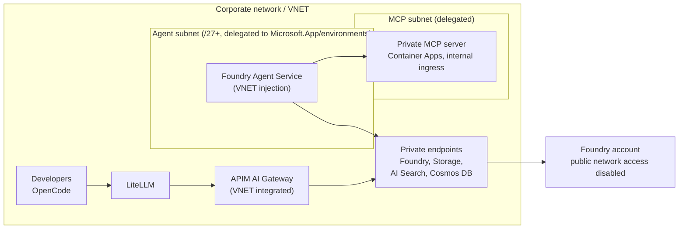

# VNET target architecture

The PoC runs **without a VNET** (public endpoints, key-less MI between APIM and Foundry). This is the target picture for production. Facts from MS Learn "Configure network isolation" (checked 2026-09-30/2026-10-21).

Three areas to secure: **inbound** (public network access flag / private endpoint), **outbound from Foundry**, **outbound from the Agent client** (VNET injection).

- VNET injection: subnet delegated to `Microsoft.App/environments`, **/27 or larger**.
- Private endpoints for Storage, AI Search and Cosmos DB are **not auto-created**; the Standard agent setup is BYO Storage/AI Search/Cosmos DB.
- Templates (foundry-samples): `15-private-network-standard-agent-setup`, `11-private-network-basic-vnet`, `19-private-network-agent-tools`.
- To verify: hosted agents (preview) with VNET, region list.

## Tool support behind a VNET (new agents)

| Support | Tools |
|---|---|
| Through your VNet | Private MCP, OpenAPI, Azure Functions, A2A |
| Via private endpoint | AI Search, File Search |
| Via MCP | Foundry IQ (preview) |
| Microsoft backbone | Code Interpreter, Function Calling |
| Works, but over public endpoints | Bing, Web search, SharePoint grounding |
| Partial | Fabric IQ |
| Not supported | Fabric Data Agent, Logic Apps, Browser Automation, Computer Use, Image Generation |

Implication for the PoC: the MCP server on Container Apps is public here; in the target it moves to a delegated MCP subnet with internal-only ingress.
